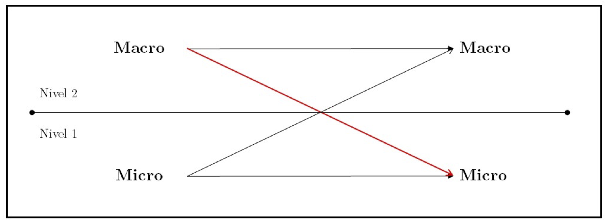
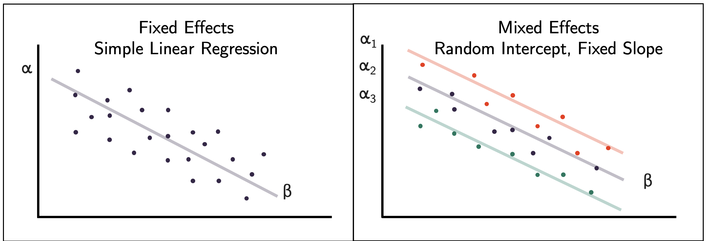
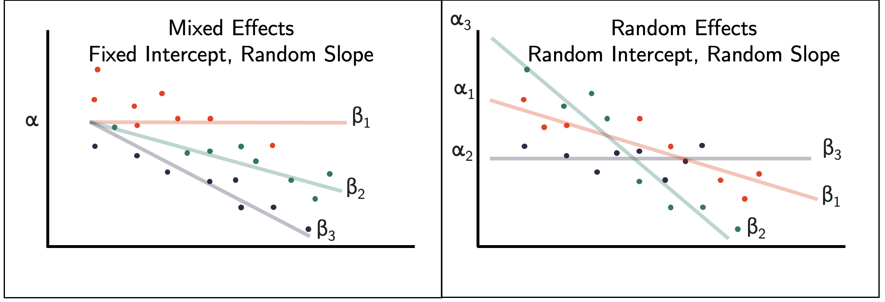

## Materiales: bases de datos

::: {style="font-size: 22px;"}
Todas las bases son **ficticias** (simuladas), pero tienen la misma estructura y nombres de variables que las bases reales.

| Archivo | Qué contiene | Grupos |
|---------------|-----------------------------------------|---------------|
| `simce_simulada.RData` | Como **SIMCE 2° medio**: una fila por estudiante (200 establecimientos). Puntaje de matemática, sexo, condición migrante, escolaridad de los padres, prácticas docentes percibidas, dependencia y ruralidad | Multinivel (un año) |
| `rendimiento_2024_2025_simulada.csv` | Como **Rendimiento Mineduc**: una fila por estudiante y año (8° básico 2024 y 1° medio 2025). Asistencia, promedio de matemática, establecimiento, IVE, dependencia y ruralidad | Multinivel (dos años) |
| `matricula_2022_simulada.csv` a `matricula_2025_simulada.csv` | Como **Matrícula por alumno Mineduc**: una fila por estudiante matriculado cada año. `MRUN`, `MRUN_IPE`, grado, establecimiento, dependencia, nacionalidad y país de origen | Supervivencia |

**Guárdenlas en una carpeta llamada `data`: los scripts las buscan en `data/`.**
:::

## Materiales: scripts

::: {style="font-size: 23px;"}
| Script | Qué hace | Grupos |
|--------------------|-----------------------------------|------------------|
| `01_manipulacion_datos.R` | Leer bases, explorar, filtrar, recodificar, valores perdidos, unir bases, agregar al nivel del establecimiento, formato largo y ancho | Todos |
| `02_construir_trayectorias.R` | Unificar identificadores (IPE → RUN), definir la cohorte, construir **tiempo** y **deserción**, verificar | Supervivencia |
| `03_descriptivos.R` | Tablas descriptivas, comparaciones por grupo, variabilidad entre establecimientos, cambio entre años, descripción de la cohorte | Todos (su sección) |
| `04_multinivel.R` | **Parte A:** un año · **Parte B:** transiciones (modelo de cambio) |
| `05_supervivencia.R` | Kaplan-Meier, log-rank, modelo de Cox, interacciones, tablas y gráficos | Supervivencia |

📂 **Carpeta de trabajo:** los scripts usan rutas relativas (`data/...`, `output/...`). Abran el proyecto de RStudio si tienen uno o, si no, indiquen la carpeta donde guardaron los materiales: `setwd()`.

💡 Las líneas marcadas con `# >>> ADAPTAR` son las que deben cambiar para trabajar con **su** base.
:::

## Objetivos de la semana

<br>

::: {style="font-size: 35px;"}
Al finalizar esta semana esperamos que cada grupo pueda **estimar e interpretar** el modelo que responde a su pregunta de investigación.

1.  Comprender **por qué** la estructura de sus datos exige modelos distintos a la regresión que ya conocen
2.  Estimar e interpretar **modelos multinivel** de intercepto aleatorio con `lme4`, incluyendo **interacciones** y datos de **dos años**
3.  Construir una base de **trayectorias** y estimar **modelos de supervivencia** con `survival`
4.  Definir el **producto mínimo** de análisis para la presentación del **3 de noviembre**
:::

## ¿Dónde estamos?

::: {style="text-align:center;"}
**Pregunta, objetivos e hipótesis**

$\downarrow$

**Operacionalización y plan de análisis**

$\downarrow$

**Tratamiento y manipulación de datos**

$\downarrow$

[**Análisis: descriptivos y modelos**]{style="color:blue;"}

$\downarrow$

**Presentación oral (3 de noviembre)**
:::

##  {background-color="#9467bd"}

::: {style="color:white; font-size:80px; font-weight:bold; text-align:center; margin-top:200px;"}
Lógica común
:::

## ¿Por qué no basta con la regresión que conocemos?

:::::: {style="font-size: 30px;"}
La regresión lineal y logística asumen que **cada observación es independiente** y que **observamos el resultado de todos los casos**. Sus datos violan alguno de estos supuestos.

::::: columns
::: {.column width="50%"}
**Datos anidados**

- Estudiantes **dentro de** establecimientos
- Estudiantes del mismo establecimiento se parecen entre sí
- La información **no es independiente**

[→ Modelos multinivel]{style="color:blue;"}
:::

::: {.column width="50%"}
**Tiempo hasta un evento**

- Seguimos estudiantes **en el tiempo**
- Interesa **si** desertan y **cuándo**
- Para algunos **no observamos** el evento (censura)

[→ Modelos de supervivencia]{style="color:blue;"}
:::
:::::
::::::

## La forma de la base depende del análisis

<br>

:::::: {style="font-size: 28px;"}
Antes de modelar, la base debe tener **la forma que el modelo necesita**.

::::: columns
::: {.column width="50%"}
**Multinivel**

Una fila por **estudiante**, con el identificador de su **establecimiento**.

| mrun | rbd | ptje_mate | ... |
|------|-----|-----------|-----|
| 101  | 25  | 263       | ... |
| 102  | 25  | 241       | ... |
| 103  | 31  | 288       | ... |
:::

::: {.column width="50%"}
**Supervivencia**

Una fila por **estudiante**, con el **tiempo** observado y si ocurrió el **evento**.

| mrun | tiempo | desercion | ... |
|------|--------|-----------|-----|
| 201  | 3      | 0         | ... |
| 202  | 1      | 1         | ... |
| 203  | 2      | 1         | ... |
:::
:::::
::::::

##  {background-color="#9467bd"}

::: {style="color:white; font-size:80px; font-weight:bold; text-align:center; margin-top:200px;"}
Modelos multinivel
:::

## Datos anidados

::: {style="font-size: 33px;"}
Los estudiantes **comparten** establecimiento: profesores, recursos, composición social y prácticas.

- El puntaje de un estudiante se relaciona con **características propias** (nivel 1) y con las de su **establecimiento** (nivel 2).
- Si ignoramos el anidamiento, los **errores estándar se subestiman** → encontramos resultados "significativos" que no lo son.
- Permite separar preguntas distintas:
  - ¿Cuánto de la desigualdad en resultados ocurre **entre** establecimientos y cuánto **dentro** de ellos?
  - ¿La composición del establecimiento importa **más allá** de las características individuales?
:::

## Relaciones micro y macro

El análisis multinivel permite estudiar relaciones entre variables definidas en **distintos niveles**: cómo el **contexto** (nivel 2) se relaciona con resultados **individuales** (nivel 1).

{width="80%" fig-align="center"}

::: {style="font-size: 26px;"}
- **Micro → micro:** escolaridad de los padres y puntaje del estudiante
- **Macro → micro:** composición social del establecimiento y puntaje del estudiante
- Las flechas indican la **dirección de la relación** que se plantea en la hipótesis; con datos observacionales estimamos **asociaciones**
:::

## El modelo de intercepto aleatorio

<br>

::: {style="font-size: 28px;"}
**Nivel 1 (estudiante *i* en establecimiento *j*):**

$$Y_{ij} = \beta_{0j} + \beta_{1}X_{ij} + e_{ij}$$

**Nivel 2 (establecimiento *j*):**

$$\beta_{0j} = \gamma_{00} + \gamma_{01}W_{j} + u_{0j}$$

**Modelo combinado:**

$$Y_{ij} = \gamma_{00} + \beta_{1}X_{ij} + \gamma_{01}W_{j} + u_{0j} + e_{ij}$$

- $\gamma_{00}$: promedio general · $u_{0j}$: desviación del establecimiento *j* respecto del promedio
- Dos varianzas: **entre** establecimientos ($\sigma^2_{u}$) y **dentro** de ellos ($\sigma^2_{e}$)
- Cada establecimiento tiene **su propio intercepto**; las pendientes son iguales para todos
:::

## Intercepto aleatorio: la idea gráfica

<br>

{width="90%" fig-align="center"}

::: {style="font-size: 26px;"}
- **Izquierda:** regresión lineal tradicional. Una sola recta para todos los estudiantes.
- **Derecha:** intercepto aleatorio. Cada establecimiento (color) tiene **su propia altura** ($\alpha_j$), pero la **misma pendiente** ($\beta$).
:::


## Nuestros datos de ejemplo

::: {style="font-size: 32px;"}
```{r echo=TRUE}
# Paquetes
library(tidyverse) # manipulación de datos y gráficos
library(lme4)      # modelos multinivel
library(texreg)    # tablas de modelos

# Base SIMCE simulada: estudiantes de 2° medio en 200 establecimientos
load("data/simce_simulada.RData")

glimpse(simce)
```
:::

## ¿Cuántos estudiantes por establecimiento?

::: {style="font-size: 32px;"}
```{r echo=TRUE}
# Número de estudiantes y de establecimientos
simce %>% summarise(n_estudiantes = n(),
                    n_establecimientos = n_distinct(rbd))

# Distribución del número de estudiantes por establecimiento
simce %>% count(rbd) %>% summarise(min = min(n), media = mean(n), max = max(n))
```

* **Revisen esto en su base:** establecimientos con muy pocos estudiantes aportan poca información sobre la varianza entre establecimientos.
:::

## Centrar variables a la gran media

::: {style="font-size: 25px;"}
**Centrar** es restar a cada valor el **promedio de toda la muestra** (la "gran media"):

$$X^{c}_{ij} = X_{ij} - \bar{X}$$

| Estudiante | Escolaridad padres | Promedio muestra | Centrada |
|------------|--------------------|------------------|----------|
| A          | 9                  | 12               | −3       |
| B          | 12                 | 12               | 0        |
| C          | 16                 | 12               | +4       |

- El **0** pasa a ser el **promedio** de la muestra (y no "0 años de escolaridad", un valor que casi no existe)
- El **intercepto** se interpreta para un estudiante con valores **promedio**
- En las **interacciones**, cada término principal se interpreta en el promedio de la otra variable
- **No cambia** las pendientes ni el ajuste del modelo: solo traslada la escala
:::

## Preparación de variables

::: {style="font-size: 27px;"}
```{r echo=TRUE}
simce <- simce %>%
  # Mismo N en todos los modelos: eliminamos casos sin escolaridad de los padres
  drop_na(ed_padres) %>%
  mutate(
    mujer       = if_else(gen_alu == 2, 1, 0),
    dependencia = factor(cod_depe2, levels = 1:3,
                         labels = c("Municipal", "Part. subvencionado", "Part. pagado")),
    rural       = cod_rural_rbd,
    # Centrado a la gran media: valor del estudiante menos el promedio de la muestra
    ed_padres_c = ed_padres - mean(ed_padres),
    # Índice de prácticas docentes percibidas (1 a 4), también centrado
    practicas_c = practicas - mean(practicas)
  ) %>%
  # Variables de nivel 2 construidas desde los estudiantes
  group_by(rbd) %>%
  mutate(
    porc_migrante   = mean(migrante) * 100,               # composición migrante
    ed_padres_media = mean(ed_padres_c)                   # composición social (centrada)
  ) %>%
  ungroup()

summary(simce$ed_padres_media)   # 0 = establecimiento con escolaridad media igual al promedio
```

`group_by()` + `mutate()` agrega información del establecimiento **sin perder** filas de estudiantes.
:::

## ¿Varían los establecimientos?

::: {style="font-size: 25px;"}
```{r echo=TRUE}
#| fig-width: 10
#| fig-height: 4.5
simce %>%
  group_by(rbd) %>%
  summarise(promedio = mean(ptje_mate2m_alu)) %>%
  ggplot(aes(x = reorder(factor(rbd), promedio), y = promedio)) +
  geom_point(color = "#9467bd") +
  geom_hline(yintercept = mean(simce$ptje_mate2m_alu), linetype = "dashed") +
  labs(x = "Establecimientos (ordenados)", y = "Puntaje promedio matemática") +
  theme_minimal() + theme(axis.text.x = element_blank())
```
:::

## Paso 1: Modelo nulo

::: {style="font-size: 30px;"}
Sin predictores. Solo separa la varianza **entre** y **dentro** de establecimientos.

```{r echo=TRUE}
m0 <- lmer(ptje_mate2m_alu ~ 1 + (1 | rbd), data = simce)
summary(m0)
```
:::

## Leyendo el modelo nulo

<br>

::: {style="font-size: 35px;"}
- `(1 | rbd)`: un **intercepto aleatorio** para cada establecimiento
- **Fixed effects – Intercept:** puntaje promedio general ($\gamma_{00}$)
- **Random effects:**
  - `rbd (Intercept)`: varianza **entre** establecimientos ($\sigma^2_{u}$)
  - `Residual`: varianza **dentro** de establecimientos ($\sigma^2_{e}$)
:::

## Correlación intraclase (CCI)

::: {style="font-size: 28px;"}
$$CCI = \frac{\sigma^2_{u}}{\sigma^2_{u} + \sigma^2_{e}}$$

```{r echo=TRUE}
varianzas <- as.data.frame(VarCorr(m0))
varianzas

var_entre  <- varianzas$vcov[1]  # entre establecimientos
var_dentro <- varianzas$vcov[2]  # dentro de establecimientos

cci <- var_entre / (var_entre + var_dentro)
round(cci, 3)
```

[El `r round(cci*100)` % de la varianza en matemática se encuentra **entre** establecimientos.]{style="color:blue;"} El resto corresponde a diferencias entre estudiantes de un mismo establecimiento.
:::

## ¿Cómo interpretar la CCI?

::: {style="font-size: 30px;"}
- Proporción de la varianza total atribuible al **nivel 2**
- También: correlación esperada entre dos estudiantes del **mismo** establecimiento
- Una CCI mayor a 0 justifica considerar el anidamiento; en SIMCE suele ser **importante**, dado el alto nivel de **segregación** del sistema escolar chileno

<br>

**Para su informe:** reporten la CCI e interprétenla sustantivamente.

> *"El `r round(cci*100)` % de la variabilidad en el puntaje de matemática se encuentra entre establecimientos, lo que indica que..."*
:::

## Paso 2: Predictores de nivel 1

<br>

::: {style="font-size: 28px;"}
```{r echo=TRUE}
m1 <- lmer(ptje_mate2m_alu ~ mujer + migrante + ed_padres_c + (1 | rbd), data = simce)
summary(m1)$coefficients
```

- **Mujer:** las estudiantes obtienen, en promedio, `r round(abs(fixef(m1)["mujer"]),1)` puntos `r ifelse(fixef(m1)["mujer"]<0,"menos","más")` que los hombres **del mismo establecimiento**, controlando por las demás variables.
- **Migrante:** diferencia de `r round(fixef(m1)["migrante"],1)` puntos respecto de estudiantes nativos.
- **Escolaridad de los padres:** por cada año adicional de escolaridad, el puntaje es, en promedio, `r round(fixef(m1)["ed_padres_c"],1)` puntos mayor.
- **Intercepto:** puntaje esperado de un hombre nativo con padres de escolaridad **promedio** (gracias al centrado).
:::

## Paso 3: Predictores de nivel 2

<br>

::: {style="font-size: 30px;"}
```{r echo=TRUE}
m2 <- lmer(ptje_mate2m_alu ~ mujer + migrante + ed_padres_c +
             dependencia + rural + porc_migrante + ed_padres_media +
             (1 | rbd), data = simce)
summary(m2)$coefficients
```
:::

## Interpretando el nivel 2

::: {style="font-size: 28px;"}
- **Dependencia:** diferencia promedio respecto de establecimientos **municipales** (categoría de referencia).
- **% migrante:** diferencia en el puntaje promedio asociada a cada punto porcentual adicional de estudiantes migrantes en el establecimiento.
- **Escolaridad media de los padres (composición):** asociación entre la composición social del establecimiento y el puntaje, **más allá** de la escolaridad de los propios padres. En la literatura se denomina **efecto contextual** o composicional, aunque con estos datos es una **asociación**.

<br>

⚠️ Con datos observacionales estos coeficientes son **asociaciones**, no efectos causales: la selección de estudiantes en establecimientos no es aleatoria.
:::

## Comparación de modelos

::: {style="font-size: 30px;"}
```{r echo=TRUE}
screenreg(list(m0, m1, m2),
          custom.model.names = c("Nulo", "Nivel 1", "Nivel 1 + 2"),
          single.row = TRUE, digits = 2)
```
:::


## Interacciones

<br>

::: {style="font-size: 26px;"}
Una **interacción** permite que la relación entre $X$ e $Y$ **varíe según** el valor de otra variable.

- **Dentro del mismo nivel:** ¿la brecha de género varía según la escolaridad de los padres? → `mujer * ed_padres_c`
- **Entre niveles** (*cross-level*): ¿la relación entre las prácticas docentes percibidas (nivel 1) y el puntaje varía según la composición social del establecimiento (nivel 2)? → `practicas_c * ed_padres_media`

$$Y_{ij} = \gamma_{00} + \beta_{1}X_{ij} + \gamma_{01}W_{j} + \gamma_{11}(X_{ij} \times W_{j}) + u_{0j} + e_{ij}$$

- $\gamma_{11}$: cuánto **cambia la pendiente** de $X$ por cada unidad de $W$
- No requiere pendientes aleatorias: sigue siendo un modelo de **intercepto aleatorio**
- **Centrar** ambas variables facilita la interpretación de los términos principales
:::

## Interacción entre niveles en R

::: {style="font-size: 28px;"}
```{r echo=TRUE}
m3 <- lmer(ptje_mate2m_alu ~ mujer + migrante + ed_padres_c +
             dependencia + rural + porc_migrante +
             practicas_c * ed_padres_media +      # incluye ambos términos principales
             (1 | rbd), data = simce)
summary(m3)$coefficients[c("practicas_c", "ed_padres_media", "practicas_c:ed_padres_media"), ]
```

- **practicas_c:** en un establecimiento de composición social **promedio** (`ed_padres_media` = 0), un punto más en el índice de prácticas se asocia a `r round(fixef(m3)["practicas_c"],1)` puntos más en matemática.
- **Interacción:** por cada año adicional de escolaridad media de los padres del establecimiento, esa pendiente es `r round(abs(fixef(m3)["practicas_c:ed_padres_media"]),1)` puntos `r ifelse(fixef(m3)["practicas_c:ed_padres_media"]<0,"menor","mayor")`. La asociación entre prácticas y puntaje es más fuerte en establecimientos de `r ifelse(fixef(m3)["practicas_c:ed_padres_media"]<0,"menor","mayor")` escolaridad media de los padres.
:::

## Visualizar la interacción

::: {style="font-size: 22px;"}
**Composición social** = `ed_padres_media`: **escolaridad promedio de los padres** de los estudiantes de cada establecimiento, centrada en la media de la muestra. Comparamos tres tipos de establecimientos: con padres que tienen, en promedio, **2 años menos**, **igual** o **2 años más** de escolaridad que el promedio.

```{r echo=TRUE}
#| fig-width: 9
#| fig-height: 2.8
b <- fixef(m3)
expand_grid(practicas_c = seq(-1, 1, .1),
            composicion = c(-2, 0, 2)) %>%     # escolaridad media de los padres del establecimiento
  mutate(grupo = factor(composicion, labels = c("2 años bajo el promedio", "Promedio",
                                                "2 años sobre el promedio")),
         predicho = b["(Intercept)"] + b["practicas_c"] * practicas_c +
           b["ed_padres_media"] * composicion +
           b["practicas_c:ed_padres_media"] * practicas_c * composicion) %>%
  ggplot(aes(practicas_c, predicho, color = grupo)) + geom_line(linewidth = 1.2) +
  labs(x = "Prácticas docentes percibidas (centradas)", y = "Puntaje predicho",
       color = "Escolaridad media de los\npadres del establecimiento") + theme_minimal()
```

Las rectas tienen **pendientes distintas** según el contexto: eso es una interacción.
:::

## Otros temas (optativos)

::::::: columns
:::: {.column width="45%"}
::: {style="font-size: 25px;"}
- **Pendientes aleatorias:** que la relación de una variable con el resultado **varíe** entre establecimientos → `(1 + migrante | rbd)`
- **Tres niveles:** estudiantes en cursos en establecimientos → `(1 | rbd/cod_curso)`
- **Centrado a la media del grupo:** separa la relación **dentro** (*within*) y **entre** (*between*) establecimientos

<br>

[Es preferible interpretar bien un modelo simple que estimar mal uno complejo.]{style="color:blue;"} Si su pregunta lo requiere, consulten Finch et al. (2014), cap. 3.
:::
::::

:::: {.column width="55%"}
{width="100%"}

::: {style="font-size: 16px;"}
Pendientes aleatorias: cada establecimiento tiene su propia pendiente ($\beta_j$).
:::
::::
:::::::

## Los mismos estudiantes en dos años

::: {style="font-size: 32px;"}
(ej. 8° básico 2024 → 1° medio 2025)

- Cada estudiante aparece **dos veces** → la información no es independiente
- En una **transición**, todos **cambian** de establecimiento
- Agregar el **año** como variable **no basta**

<br>

[→ Usamos un modelo de **cambio**: la diferencia entre ambos años como variable dependiente]{style="color:blue;"}
:::


## Transiciones: de formato largo a ancho

::: {style="font-size: 26px;"}
Las bases de Mineduc son **anuales** (formato largo: una fila por estudiante y año). Para el modelo necesitamos **una fila por estudiante** con la información de ambos años (formato ancho).
:::

{width="85%" fig-align="center"}

## Transiciones: la base ancha en R

::: {style="font-size: 30px;"}
```{r echo=TRUE}
transicion <- read_csv2("data/rendimiento_2024_2025_simulada.csv", show_col_types = FALSE)

trans_ancha <- transicion %>%
  select(MRUN, GEN_ALU, AGNO, RBD, RURAL_RBD, COD_DEPE2, IVE, ASISTENCIA, PROM_MATE) %>%
  pivot_wider(names_from = AGNO,
              values_from = c(RBD, RURAL_RBD, COD_DEPE2, IVE, ASISTENCIA, PROM_MATE))
names(trans_ancha)
```

Cada variable que cambia entre años queda **duplicada** con el sufijo del año (`_2024`, `_2025`).
:::

## El modelo de cambio

::: {style="font-size: 25px;"}
Pregunta: **¿varía la asistencia entre 2024 y 2025? ¿Para quiénes varía más?**

Una fila por estudiante. La variable dependiente es el **cambio** entre ambos años:

$$\Delta Y_{i} = Y_{i,2025} - Y_{i,2024} = \gamma_{00} + \beta_{1}X_{i} + \gamma_{01}W_{j} + u_{0j} + e_{ij}$$

- $j$: establecimiento de **destino** (donde se mide el resultado de 2025)
-   $\gamma_{00}$ (**intercepto**): en el modelo **nulo**, es el **cambio promedio**; con predictores, es el cambio esperado para la **categoría de referencia** (ej. hombres de origen urbano)
- $\beta_{1}$, $\gamma_{01}$: si el cambio es **mayor o menor** según características del estudiante o de los establecimientos de origen y destino
- Valores negativos: la asistencia **disminuye**; positivos: **aumenta**
:::

## Modelo de cambio: ¿cambia la asistencia?

::: {style="font-size: 23px;"}
```{r echo=TRUE}
trans_ancha <- trans_ancha %>%
  mutate(cambio_asistencia = ASISTENCIA_2025 - ASISTENCIA_2024,
         mujer = if_else(GEN_ALU == 2, 1, 0),
         origen_rural = RURAL_RBD_2024,
         dif_ive = IVE_2025 - IVE_2024)            # >0: el destino es más vulnerable que el origen

# Cambio promedio y prueba t pareada (sin considerar el anidamiento)
t.test(trans_ancha$ASISTENCIA_2025, trans_ancha$ASISTENCIA_2024, paired = TRUE)$estimate

# ¿Cuántos estudiantes de la cohorte llegan a cada establecimiento de destino?
trans_ancha %>% count(RBD_2025) %>% summarise(min = min(n), mediana = median(n), max = max(n))

# Modelo nulo de cambio: el intercepto es el cambio promedio
m_c0 <- lmer(cambio_asistencia ~ 1 + (1 | RBD_2025), data = trans_ancha)
summary(m_c0)$coefficients %>% round(2)
```

- En promedio, la asistencia `r ifelse(fixef(m_c0)[1]<0,"disminuye","aumenta")` `r round(abs(fixef(m_c0)[1]),1)` puntos porcentuales entre 8° básico y 1° medio.
:::

## Modelo de cambio: ¿para quiénes cambia más?

::: {style="font-size: 25px;"}
```{r echo=TRUE}
trans_ancha <- trans_ancha %>%
  mutate(dif_ive_c = dif_ive - mean(dif_ive))   # centramos solo la variable continua

m_c1 <- lmer(cambio_asistencia ~ mujer + origen_rural + dif_ive_c +
               (1 | RBD_2025), data = trans_ancha)
summary(m_c1)$coefficients %>% round(2)
```

-   **Intercepto:** cambio esperado para un **hombre** de origen **urbano**, con una diferencia de IVE promedio.
-   **Mujer:** el cambio de las mujeres es `r round(abs(fixef(m_c1)["mujer"]),1)` puntos `r ifelse(fixef(m_c1)["mujer"]<0,"más negativo","más positivo")` que el de los hombres que llegan al mismo establecimiento.
-   **Origen rural:** el cambio de quienes vienen de escuelas rurales es `r round(abs(fixef(m_c1)["origen_rural"]),1)` puntos `r ifelse(fixef(m_c1)["origen_rural"]<0,"más negativo","más positivo")` que el de quienes vienen de escuelas urbanas.
-   **Diferencia de IVE:** por cada punto adicional de vulnerabilidad del destino respecto del origen, el cambio es `r round(abs(fixef(m_c1)["dif_ive_c"]),2)` puntos `r ifelse(fixef(m_c1)["dif_ive_c"]<0,"más negativo","más positivo")`.
:::

## ¿Y el establecimiento de origen?

<br>

::: {style="font-size: 30px;"}
Cada estudiante pertenece a **dos** establecimientos que **no están anidados** entre sí → modelo de **clasificación cruzada**.

```{r echo=TRUE}
m_c_cruz <- lmer(cambio_asistencia ~ mujer + origen_rural + dif_ive_c +
                   (1 | RBD_2024) + (1 | RBD_2025), data = trans_ancha)
VarCorr(m_c_cruz)
```

- Una varianza para el establecimiento de **origen** y otra para el de **destino**
- Es una **extensión opcional**: el modelo con solo el destino es suficiente para su presentación
:::

## Advertencias para transiciones

::: {style="font-size: 27px;"}
- ⚠️ **Selección:** los estudiantes no se asignan al azar a los establecimientos de destino
- ⚠️ **Pocos estudiantes por establecimiento:** la cohorte se dispersa; revisen la distribución antes de interpretar la varianza
- ⚠️ **Notas:** los criterios de calificación **difieren** entre establecimientos y entre básica y media. El **cambio promedio** (intercepto) puede reflejar en parte criterios más exigentes en media; interpreten sobre todo las **diferencias entre grupos**
- ⚠️ **Nivel de partida:** si los grupos parten de niveles distintos, el modelo de cambio y un modelo que controla por el año anterior (**modelo con rezago**) pueden dar resultados distintos. El script incluye el modelo con rezago como **análisis de robustez**
- ⚠️ **Quiénes quedan fuera:** si excluyen a quienes no completan la transición, analizan solo una parte de la cohorte
:::

## Actividad: aplicación a sus datos (multinivel)

<br>

::: {style="font-size: 28px;"}
Con el script `04_multinivel.R` y **su propia base**:

1.  Identifiquen su **variable dependiente** y el identificador de **nivel 2** (`rbd`)
2.  Revisen el número de estudiantes por establecimiento
3.  Estimen el **modelo nulo** y calculen la **CCI**
4.  Escriban **una oración** que interprete la CCI
5.  Si alcanzan: agreguen sus predictores de **nivel 1**

* **Grupos con dos años (Parte B del script):** primero construyan la base **ancha** (una fila por estudiante), calculen el **cambio** y estimen el modelo nulo de cambio.

:::

##  {background-color="#9467bd"}

::: {style="color:white; font-size:80px; font-weight:bold; text-align:center; margin-top:200px;"}
Modelos de supervivencia
:::

## ¿Qué preguntas responde?

::: {style="font-size: 33px;"}
No solo **si** ocurre un evento, sino **cuándo** ocurre.

- ¿Qué proporción de estudiantes que ingresó a 1° medio en 2022 **permanece** en el sistema escolar cada año?
- ¿En qué **momento** de la trayectoria se concentra la deserción?
- ¿El riesgo de desertar es mayor para estudiantes **migrantes**? ¿Difiere según **país de origen**?

<br>

En la literatura: *survival analysis*, *event history analysis*, *análisis de historia de eventos*.
:::

## Conceptos básicos

::: {style="font-size: 27px;"}
| Concepto | Definición | En nuestro caso |
|------------------------|------------------------|------------------------|
| **Evento** | Cambio de estado que nos interesa | Desertar del sistema escolar |
| **Tiempo** | Duración desde el origen hasta el evento o fin de la observación | Años desde 1° medio (2022) |
| **Censura** | No observamos el evento durante el seguimiento | Siguen matriculados en 2025 |
| **Población en riesgo** | Quienes aún pueden experimentar el evento | Matriculados al inicio del año |
:::

<br>

::: {style="font-size: 27px;"}
⚠️ La censura **no** significa que el estudiante no desertará: significa que **no lo sabemos**. Por eso no basta con una regresión logística sobre "desertó sí/no".
:::

## Tiempo calendario y tiempo de análisis

```{r echo=FALSE}
#| fig-width: 11
#| fig-height: 4.6
ej <- tibble(est = factor(paste("Estudiante", 1:5), levels = paste("Estudiante", 5:1)),
             fin = c(3, 1, 3, 2, 3), evento = c(0, 1, 0, 1, 0))
bind_rows(ej %>% mutate(panel = "Tiempo calendario", ini = 2022, fin = 2022 + fin),
          ej %>% mutate(panel = "Tiempo de análisis (años desde 1° medio)", ini = 0)) %>%
  mutate(panel = factor(panel, levels = c("Tiempo calendario",
                                          "Tiempo de análisis (años desde 1° medio)")),
         tipo = if_else(evento == 1, "Deserción (evento)", "Censura (sigue matriculado en 2025)")) %>%
  ggplot(aes(y = est)) +
  geom_segment(aes(x = ini, xend = fin, yend = est), linewidth = 1.2, color = "grey50") +
  geom_point(aes(x = fin, shape = tipo, color = tipo), size = 5, stroke = 1.5) +
  scale_shape_manual(values = c(1, 4)) +
  scale_color_manual(values = c("#6495ED", "#9467bd")) +
  facet_wrap(~ panel, scales = "free_x") +
  labs(x = NULL, y = NULL, shape = NULL, color = NULL) +
  theme_minimal(base_size = 16) + theme(legend.position = "bottom")
```

::: {style="font-size: 24px;"}
Convertimos los **años calendario** (2022–2025) en **tiempo desde el origen**. Cada estudiante aporta su tiempo hasta desertar (✕) o hasta el fin del seguimiento (○). Ver Moore (2016), cap. 1.
:::

## Dos funciones clave

::: {style="font-size: 28px;"}
**Función de supervivencia** $S(t)$: probabilidad de **no** haber experimentado el evento hasta el tiempo $t$.

> $S(2) = 0{,}90$ → el 90 % de la cohorte permanece en el sistema después de dos años.

<br>

**Función de riesgo** $h(t)$: probabilidad de experimentar el evento en $t$, **dado que** no ha ocurrido antes.

> $h(2) = 0{,}04$ → entre quienes siguen matriculados al inicio del segundo año, el 4 % deserta ese año.

<br>

* Los modelos de regresión de supervivencia modelan el **riesgo**.
:::

## La forma del riesgo define la supervivencia

```{r echo=FALSE}
#| fig-width: 11
#| fig-height: 4.3
riesgos <- tibble(t = rep(1:3, 2),
                  escenario = rep(c("Riesgo alto al inicio", "Riesgo creciente"), each = 3),
                  h = c(.10, .05, .02, .02, .05, .10)) %>%
  group_by(escenario) %>% mutate(S = cumprod(1 - h)) %>% ungroup()
pan_h <- "Función de riesgo h(t)"; pan_s <- "Función de supervivencia S(t)"
datos_s <- bind_rows(tibble(t = 0, escenario = unique(riesgos$escenario), S = 1), riesgos) %>%
  mutate(panel = pan_s)
ggplot() +
  geom_col(data = riesgos %>% mutate(panel = pan_h),
           aes(t, h, fill = escenario), position = "dodge") +
  geom_step(data = datos_s, aes(t, S, color = escenario), linewidth = 1.3) +
  facet_wrap(~ factor(panel, levels = c(pan_h, pan_s)), scales = "free_y") +
  scale_fill_manual(values = c("#6495ED", "#9467bd")) +
  scale_color_manual(values = c("#6495ED", "#9467bd")) +
  labs(x = "Año", y = NULL, fill = NULL, color = NULL) +
  theme_minimal(base_size = 15) + theme(legend.position = "bottom")
```

::: {style="font-size: 24px;"}
Ambos escenarios terminan con una supervivencia similar, pero la deserción ocurre en **momentos distintos**. Ver Moore (2016), cap. 2.
:::

## Construcción de la base: decisiones

::: {style="font-size: 27px;"}
Los archivos de matrícula son **anuales**: hay que **unirlos** por `MRUN` para reconstruir trayectorias.

1.  **Origen:** estudiantes en 1° medio en 2022 (`COD_ENSE` 310 o 410, `COD_GRADO` = 1)
2.  **Deserción:** el estudiante **no aparece** en ningún establecimiento al año siguiente
3.  **Cambio de establecimiento:** **no** es deserción (sigue en la base con otro `RBD`)
4.  **Repitencia:** **no** es deserción (sigue matriculado)
5.  **Salidas transitorias:** si sale y reingresa, contamos la **primera salida** como evento
6.  **Censura:** quienes siguen matriculados en 2025
7.  **Cambio de identificador (IPE → RUN):** unificar el `MRUN` **antes** de definir la cohorte

<br>

⚠️ Con 4 años de datos solo observamos **3 transiciones**: 2022→2023, 2023→2024 y 2024→2025.
:::

## Un problema: estudiantes con IPE

<br>

::: {style="font-size: 32px;"}
Quienes ingresan al sistema **sin RUN** reciben un **Identificador Provisorio Escolar (IPE)**. Al regularizar su situación, obtienen un RUN y **cambian de** `MRUN`.

| Año            | `MRUN` | `MRUN_IPE` |
|----------------|--------|------------|
| 2024 (con IPE) | 45     | —          |
| 2025 (con RUN) | 75     | 45         |

- Sin corrección, el estudiante 45 **"deserta"** en 2025 y el 75 **no pertenece** a la cohorte
- El error **no es aleatorio**: afecta a estudiantes **migrantes** que regularizan su situación → **sobrestima** su riesgo de deserción
- `MRUN_IPE` registra el IPE **anterior** de quienes ya tienen RUN
:::

## Construcción de la base en R (I): unificar identificadores

::: {style="font-size: 25px;"}
```{r echo=TRUE}
library(survival)

# 1. Leer y unir los archivos anuales (formato Mineduc: separador ";")
matricula <- map_dfr(2022:2025, ~ read_csv2(paste0("data/matricula_", .x, "_simulada.csv"),
                                            col_types = cols(MRUN_IPE = col_double()),
                                            show_col_types = FALSE))

# 2. Tabla de equivalencias: IPE anterior → RUN definitivo
equiv <- matricula %>%
  filter(!is.na(MRUN_IPE), MRUN != MRUN_IPE) %>%
  distinct(MRUN_IPE, MRUN_nuevo = MRUN)

equiv %>% count(MRUN_IPE) %>% filter(n > 1) %>% nrow()   # IPE asociados a más de un RUN

equiv <- equiv %>% add_count(MRUN_IPE) %>% filter(n == 1) %>% select(-n)   # se excluyen

# 3. Identificador único para todos los años
matricula <- matricula %>%
  left_join(equiv, by = c("MRUN" = "MRUN_IPE")) %>%
  mutate(MRUN_unico = coalesce(MRUN_nuevo, MRUN)) %>%
  select(-MRUN_nuevo)

sum(matricula$MRUN != matricula$MRUN_unico)   # registros corregidos
```
:::

## Construcción de la base en R (II): cohorte y presencia

::: {style="font-size: 27px;"}
```{r echo=TRUE}
# 4. Cohorte: 1° medio en 2022
cohorte <- matricula %>%
  filter(AGNO == 2022, COD_ENSE %in% c(310, 410), COD_GRADO == 1)

# 5. ¿Está matriculado cada año? (en cualquier establecimiento)
presencia <- matricula %>%
  filter(MRUN_unico %in% cohorte$MRUN_unico) %>%
  distinct(MRUN_unico, AGNO) %>%
  mutate(matriculado = 1) %>%
  pivot_wider(names_from = AGNO, values_from = matriculado,
              names_prefix = "mat_", values_fill = 0)

head(presencia)
```
:::

## Tiempo y evento

::: {style="font-size: 26px;"}
```{r echo=TRUE}
surv_data <- cohorte %>%
  left_join(presencia, by = "MRUN_unico") %>%
  mutate(
    # Tiempo: año de la primera salida, o 3 si nunca sale (censura)
    tiempo = case_when(mat_2023 == 0 ~ 1,
                       mat_2024 == 0 ~ 2,
                       mat_2025 == 0 ~ 3,
                       TRUE          ~ 3),
    # Evento: 1 si deserta en algún momento, 0 si está censurado
    desercion = if_else(mat_2023 == 0 | mat_2024 == 0 | mat_2025 == 0, 1, 0),
    # País de origen (Anexo XIII, libro de códigos de Matrícula)
    migrante = if_else(PAIS_ORIGEN_ALU %in% c(0, 6), 0, 1),
    pais = case_when(PAIS_ORIGEN_ALU %in% c(0, 6) ~ "Chile",
                     PAIS_ORIGEN_ALU == 27        ~ "Venezuela",
                     PAIS_ORIGEN_ALU == 22        ~ "Perú",
                     TRUE                         ~ "Otro país"),
    pais = factor(pais, levels = c("Chile", "Venezuela", "Perú", "Otro país")),
    hombre = if_else(GEN_ALU == 1, 1, 0)
  )

surv_data %>% count(tiempo, desercion)
```
:::

## Verificar antes de modelar ✅

::: {style="font-size: 30px;"}
```{r echo=TRUE}
# ¿Un identificador por estudiante en la cohorte?
sum(duplicated(surv_data$MRUN_unico))

# ¿Cuántos salen y luego reingresan? (salidas transitorias)
surv_data %>% filter(mat_2023 == 0, mat_2024 == 1 | mat_2025 == 1) %>% nrow()

# Proporción de deserción por condición migrante
surv_data %>% group_by(migrante) %>%
  summarise(n = n(), desercion = round(mean(desercion) * 100, 1))
```

⚠️ La corrección de IPE **no** resuelve la salida del país: un estudiante que emigra sigue apareciendo como desertor.
:::

## ¿Importa la corrección de IPE?

<br>

::: {style="font-size: 24px;"}
```{r echo=FALSE}
construir <- function(mat, id) {
  coh <- mat %>% filter(AGNO == 2022, COD_ENSE %in% c(310, 410), COD_GRADO == 1)
  pres <- mat %>% filter(.data[[id]] %in% coh[[id]]) %>% distinct(id = .data[[id]], AGNO) %>%
    mutate(m = 1) %>% pivot_wider(names_from = AGNO, values_from = m, names_prefix = "mat_", values_fill = 0)
  coh %>% mutate(id = .data[[id]]) %>% left_join(pres, by = "id") %>%
    mutate(tiempo = case_when(mat_2023 == 0 ~ 1, mat_2024 == 0 ~ 2, TRUE ~ 3),
           desercion = as.integer(mat_2023 == 0 | mat_2024 == 0 | mat_2025 == 0),
           migrante = as.integer(!PAIS_ORIGEN_ALU %in% c(0, 6)))
}
comp <- map_dfr(c("Sin corrección (MRUN)" = "MRUN", "Con corrección (MRUN_unico)" = "MRUN_unico"),
                function(id) {
                  d <- construir(matricula, id)
                  tibble(Eventos = sum(d$desercion),
                         `% deserción migrantes` = round(mean(d$desercion[d$migrante == 1]) * 100, 1),
                         `% deserción nativos` = round(mean(d$desercion[d$migrante == 0]) * 100, 1),
                         `HR migrante` = round(exp(coef(coxph(Surv(tiempo, desercion) ~ migrante, data = d))), 2))
                }, .id = "Base")
knitr::kable(comp)
```
:::

<br>

::: {style="font-size: 27px;"}
[Sin unificar identificadores, la deserción migrante y su razón de riesgos quedan **sobrestimadas**.]{style="color:blue;"} Las salidas "falsas" corresponden a estudiantes que regularizaron su situación.
:::

## Kaplan-Meier: supervivencia de la cohorte

::: {style="font-size: 30px;"}
Estimador **no paramétrico** de $S(t)$: no asume ninguna forma para la curva.

```{r echo=TRUE}
km_total <- survfit(Surv(tiempo, desercion) ~ 1, data = surv_data)
summary(km_total)
```

- `n.risk`: estudiantes en riesgo al inicio de cada año
- `n.event`: deserciones en ese año
- `survival`: proporción acumulada que **permanece** en el sistema
:::

## Kaplan-Meier por condición migrante

::: {style="font-size: 23px;"}
```{r echo=TRUE}
#| fig-width: 9
#| fig-height: 4.5
km_mig <- survfit(Surv(tiempo, desercion) ~ migrante, data = surv_data)

plot(km_mig, col = c("#6495ED", "#9467bd"), lwd = 2, ylim = c(.7, 1), xaxt = "n",
     xlab = "Años desde 1° medio (2022)", ylab = "Proporción que permanece")
axis(1, at = 0:3)
legend("bottomleft", legend = c("Nativos", "Migrantes"),
       col = c("#6495ED", "#9467bd"), lwd = 2, bty = "n")
```
:::

## Prueba log-rank

::: {style="font-size: 25px;"}
¿Las curvas de supervivencia difieren significativamente entre grupos?

```{r echo=TRUE}
survdiff(Surv(tiempo, desercion) ~ migrante, data = surv_data)
survdiff(Surv(tiempo, desercion) ~ pais, data = surv_data)
```

- $H_0$: las curvas son iguales en todos los grupos
- *p* \< 0,05 → al menos un grupo tiene una trayectoria de permanencia distinta
:::

## Modelo de Cox (riesgos proporcionales)

::: {style="font-size: 26px;"}
Permite estimar la asociación de **varias variables** con el riesgo, controlando por las demás.

$$h_i(t) = h_0(t) \cdot \exp(\beta_1 X_{1i} + \beta_2 X_{2i} + \dots)$$

- $h_0(t)$: riesgo **base**; no se estima ni se asume una forma para él
- $\exp(\beta)$: **razón de riesgos** (*hazard ratio*, HR)
  - HR \> 1 → mayor riesgo de desertar
  - HR \< 1 → menor riesgo de desertar
  - HR = 1 → sin asociación

La lógica es similar a los *odds ratio* de la regresión logística.
:::

## Modelo de Cox en R

::: {style="font-size: 30px;"}
```{r echo=TRUE}
surv_data <- surv_data %>%
  mutate(dependencia = factor(COD_DEPE2, levels = 1:3,
                              labels = c("Municipal", "Part. subvencionado", "Part. pagado")),
         tecnico_prof = if_else(COD_ENSE == 410, 1, 0))

cox1 <- coxph(Surv(tiempo, desercion) ~ pais + hombre + dependencia + tecnico_prof,
              data = surv_data, ties = "efron")
summary(cox1)$conf.int[, -2] %>% round(2)
```

- **Venezuela:** el riesgo de desertar es `r round(exp(coef(cox1))["paisVenezuela"], 2)` veces el de estudiantes chilenos, controlando por las demás variables.
- **Hombre:** riesgo `r round((exp(coef(cox1))["hombre"]-1)*100)` % mayor que el de las mujeres.
:::

## Supuesto de riesgos proporcionales

::: {style="font-size: 30px;"}
El modelo de Cox asume que el HR es **constante en el tiempo**: la diferencia relativa entre grupos es la misma en cada año.

```{r echo=TRUE}
cox.zph(cox1)
```

- *p* \> 0,05 → no hay evidencia de que el supuesto se viole
- Si se viola: estratificar (`strata()`) o permitir que el HR cambie en el tiempo (Moore, 2016, cap. 7)
:::

## Interacciones en el modelo de Cox

::: {style="font-size: 28px;"}
¿La brecha de riesgo entre migrantes y nativos **varía según** la dependencia del establecimiento?

```{r echo=TRUE}
surv_data <- surv_data %>% mutate(municipal = if_else(COD_DEPE2 == 1, 1, 0))

cox_a <- coxph(Surv(tiempo, desercion) ~ migrante + municipal + hombre, data = surv_data)
cox_b <- coxph(Surv(tiempo, desercion) ~ migrante * municipal + hombre, data = surv_data)
anova(cox_a, cox_b)                 # ¿mejora el ajuste al agregar la interacción?
round(exp(coef(cox_b)), 2)
```

- **HR migrante** en establecimientos **no municipales**: `exp(migrante)` = `r round(exp(coef(cox_b))["migrante"], 2)`
- **HR migrante** en establecimientos **municipales**: `exp(migrante + migrante:municipal)` = `r round(exp(coef(cox_b)["migrante"] + coef(cox_b)["migrante:municipal"]), 2)`
- Si la interacción no es significativa, se informa el **modelo sin interacción**
:::

## Una advertencia: tiempo anual

<br>

::: {style="font-size: 28px;"}
Nuestro tiempo se mide en **años** (1, 2 o 3): muchos estudiantes desertan "al mismo tiempo" (**empates**).

- El modelo de Cox maneja empates con correcciones como `ties = "efron"` (la opción por defecto en R)
- Una alternativa es el **modelo de supervivencia en tiempo discreto**: una regresión logística sobre una base **persona-año**

<br>

[Para su presentación, Kaplan-Meier + log-rank + un modelo de Cox bien interpretado es suficiente.]{style="color:blue;"}
:::

## Actividad: aplicación a sus datos (supervivencia)

<br>

::: {style="font-size: 28px;"}
Con los scripts `02_construir_trayectorias.R` y `05_supervivencia.R`:

1.  Unan los archivos de matrícula 2022–2025 y definan la **cohorte**
2.  Construyan las variables **tiempo** y **deserción**
3.  Hagan los **chequeos** de verificación
4.  Estimen las curvas de **Kaplan-Meier** total y por condición migrante o país de origen
5.  Si alcanzan: prueba **log-rank**

:::

##  {background-color="#9467bd"}

::: {style="color:white; font-size:80px; font-weight:bold; text-align:center; margin-top:200px;"}
Miércoles: presentar resultados
:::

## ¿Qué reportar? Modelos multinivel

<br>

::: {style="font-size: 28px;"}
1.  **Descriptivos:** N de estudiantes y de establecimientos; media y DE de las variables
2.  **CCI** del modelo nulo, interpretada sustantivamente
3.  **Tabla de modelos** (nulo, nivel 1, nivel 1 + 2) con coeficientes, errores estándar, varianzas y ajuste (AIC/BIC)
4.  **Interpretación** de los coeficientes vinculada a sus **hipótesis**

```{r echo=TRUE, eval=FALSE}
# Exportar la tabla a Word
htmlreg(list(m0, m1, m2), file = "output/tabla_multinivel.doc",
        custom.model.names = c("Nulo", "Nivel 1", "Nivel 1 + 2"))
```
:::

## ¿Qué reportar? Modelos de supervivencia

<br>

::: {style="font-size: 28px;"}
1.  **Descripción de la cohorte:** N, eventos, censurados
2.  **Curvas de Kaplan-Meier** por el grupo de interés (gráfico)
3.  **Prueba log-rank**
4.  **Tabla del modelo de Cox** con HR e intervalos de confianza al 95 %
5.  **Interpretación** de los HR vinculada a sus **hipótesis** (ej. "el riesgo de desertar de estudiantes venezolanos es 1,7 veces el de estudiantes chilenos, controlando por...")

```{r echo=TRUE, eval=FALSE}
# Exportar la tabla a Word con HR e intervalos de confianza al 95 %
hr <- summary(cox1)$conf.int
htmlreg(cox1, file = "output/tabla_cox.doc",
        override.coef = list(hr[, "exp(coef)"]),
        override.ci.low = list(hr[, "lower .95"]),
        override.ci.up = list(hr[, "upper .95"]),
        ci.test = 1)   # IC que no incluye 1 → significativo
```
:::


## Errores frecuentes al interpretar

::: {style="font-size: 33px;"}
- ❌ "Ser migrante **causa** un menor puntaje" → ✅ "Se **asocia** a..."
- ❌ Interpretar coeficientes de nivel 2 como características de los **estudiantes**
- ❌ Comparar modelos estimados con **distinto número de casos**
- ❌ Interpretar un término principal **sin considerar** su interacción
- ❌ Leer un HR de 1,8 como "80 % **más probabilidad**" → ✅ "un riesgo 80 % **mayor**"
- ❌ Tratar a los censurados como estudiantes que **no desertaron**
- ❌ Reportar coeficientes sin vincularlos a la **pregunta de investigación**
:::


## Hoja de ruta hacia el 3 de noviembre

:::::: {style="font-size: 26px;"}
| Semana | Tarea |
|------------------------------------|------------------------------------|
| **Esta semana** | Base analítica construida · modelo nulo / Kaplan-Meier |
| **Próxima semana** | Clases de análisis cualitativo · avanzar en modelos de forma autónoma |
| **Antes del 3 de noviembre** | Modelos finales · tablas y gráficos · interpretación |

<br>

**Producto mínimo para la presentación:**

::::: columns
::: {.column width="50%"}
**Multinivel:** modelo nulo y CCI, un modelo con predictores, tabla de resultados e interpretación. **Transiciones:** modelo de cambio con el destino como nivel 2.
:::

::: {.column width="50%"}
**Supervivencia:** Kaplan-Meier por grupo, log-rank, modelo de Cox con HR e interpretación.
:::
:::::
::::::

## Para cerrar

<br>

::: {style="font-size: 35px;"}
- Los modelos que usamos dependen de **cómo se generaron los datos**: anidamiento y tiempo.
- La mayor parte del trabajo está en **construir correctamente la base**.
- Un modelo se justifica por la **pregunta de investigación**, no por su complejidad.

<br>

[¡Los scripts están comentados paso a paso para que puedan avanzar de forma autónoma!]{style="color:blue;"}
:::

## Referencias

Downey, D. B., y Condron, D. J. (2016). Fifty years since the Coleman Report: Rethinking the relationship between schools and inequality. *Sociology of Education, 89*(3), 207–220. <https://doi.org/10.1177/0038040716651676>

Finch, W. H., Bolin, J. E., y Kelley, K. (2014). *Multilevel modeling using R*. CRC Press.

Moore, D. F. (2016). *Applied survival analysis using R*. Springer.

